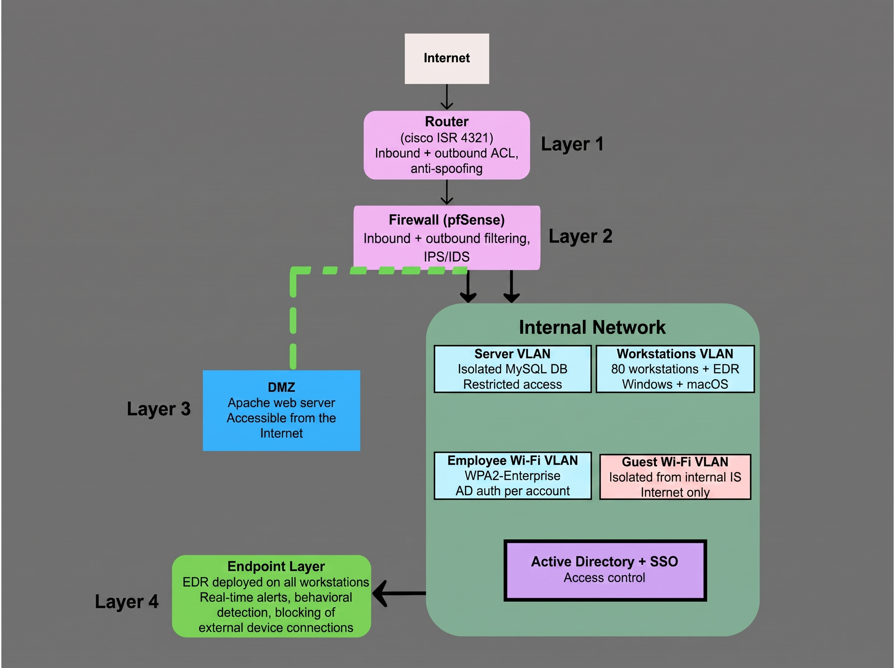
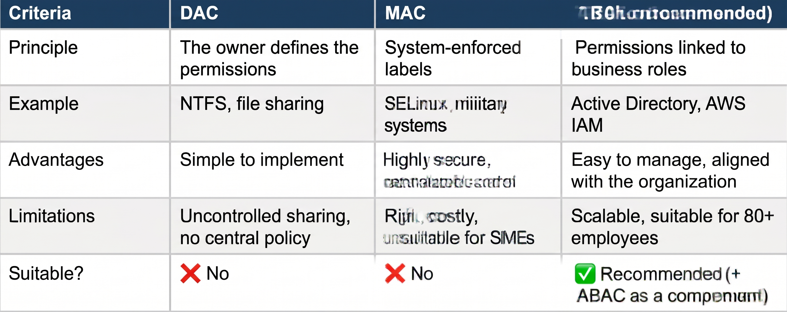
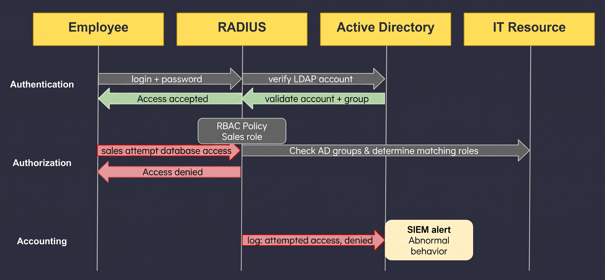

# sme-incident-response-defense-in-depth
End-to-end SME incident response and security hardening case study covering Defense-in-Depth, RBAC/AAA architecture, and MITRE ATT&amp;CK Threat Intelligence.

Architecture & Threat Intelligence


> **Capstone project completed as part of the Cisco CyberOps Associate certification.**
>
> *OPSEC & Confidentiality Notice: This repository presents a sanitized case study based on a fictional SME scenario. In accordance with operational security best practices, all personal names, company identifiers, specific Indicators of Compromise (IOCs), and sensitive metrics have been anonymized or redacted.*

---

## 1. Context & Incident Scenario

This project evaluates and remediates the security posture of a mid-sized e-commerce company (approx 80 employees) operating a public-facing web storefront, a customer database storing Personally Identifiable Information (PII) and payment records, and an internal Information System (IS).

### The Simulated Security Incident

Two critical anomalies were detected concurrently by the IT team:

1. **Insider Threat & Physical Exfiltration:** Unauthorized access by a sales representative to the complete customer database, followed by the bulk export of 2300 customer PII and financial records onto an unauthorized removable USB storage device.
2. **External Threat & C2 Beaconing:** Detection of suspicious, recurring outbound network traffic directed toward an anonymization network (Tor exit node) and a suspicious external domain.

### Baseline Infrastructure Assessment (Identified Vulnerabilities)

The initial audit revealed a flat network topology and an absence of layered security controls:

| Component | Baseline State | Critical Vulnerability / Risk |
| :--- | :--- | :--- |
| **Edge Router** | Cisco ISR 4321 (No ACLs) | Vulnerable to IP spoofing, port scanning, and DDoS from WAN |
| **Perimeter Firewall** | pfSense (Basic ingress rules only) | No egress filtering, allowing silent C2 and data exfiltration |
| **Core Switch (L2)** | Cisco Catalyst 2960 (Single `VLAN 1`) | Flat network enabling unrestricted lateral movement to servers |
| **Web Server** | Apache on Ubuntu 22.04 (No DMZ) | Directly exposed to Internet while bridged to the internal LAN |
| **Database Server** | MySQL 8.0 (User subnet, no audit logs) | Direct exposure to workstations; no visibility into data tampering |
| **Endpoints** | 60 Windows 11 + 20 macOS (No EDR) | No behavioral monitoring; unrestricted USB mass storage ports |
| **IAM & Wi-Fi** | Local accounts; single WPA2-PSK SSID | No RBAC/SSO; guest devices share network segment with employees |

---

## 2. Defense-in-Depth Architecture

To eliminate single points of failure, the infrastructure was redesigned around a **4-Layer Defense-in-Depth** model supported by a transversal identity governance layer:



### Architectural Controls Implemented

* **Layer 1 — Perimeter Filtering (Edge Router):** Deployed ingress and egress Access Control Lists (ACLs) enforcing RFC 1918 anti-spoofing and dropping unsolicited packets before reaching the firewall (see [`artifacts/edge-router-acl.txt`](artifacts/edge-router-acl.txt)).
* **Layer 2 — Deep Inspection & Egress Control (Firewall + IDS/IPS):** Enabled stateful bidirectional filtering to block unauthorized outbound connections (including Tor relays) alongside real-time IDS/IPS behavioral inspection.
* **Layer 3 — Strict Network Segmentation (`DMZ + 4 VLANs`):**
  * **DMZ:** Isolated the public-facing Apache web server from the internal LAN.
  * **4 Segmented VLANs:** Separated **Servers (MySQL)**, **Employee Workstations**, **Corporate Wi-Fi (WPA2-Enterprise)**, and **Guest Wi-Fi (Internet-only)**.
* **Layer 4 — Endpoint Detection & Response (EDR):** Deployed EDR agents across all 80 Windows/macOS endpoints to detect anomalous file operations in real time and block unauthorized USB mass storage devices.
* **Transversal Layer — Centralized Identity (Active Directory + SSO):** Replaced decentralized local accounts with centralized identity lifecycle management and auditing.

---

## 3. Access Control & AAA Framework

### Incident Impact Analysis (CIA Triad)

* **Confidentiality (`BREACHED`):** Unauthorized access and physical extraction of customer PII and financial data via USB, triggering mandatory **GDPR** breach notification obligations within 72 hours.
* **Integrity (`COMPROMISED / THREATENED`):** The absence of database audit logging made it impossible to guarantee that customer records had not been altered or deleted.
* **Availability (`AT RISK`):** Outbound C2 communications indicated a potential active malware implant, posing an immediate risk of ransomware deployment or operational downtime.

### Access Governance Model (`RBAC + ABAC / Zero Trust`)

Transitioned away from ad-hoc Discretionary Access Control (DAC) to **Role-Based Access Control (RBAC)** enriched with **Attribute-Based Access Control (ABAC)** policies (contextual verification of device compliance, corporate network location, and working hours) aligned with **Zero Trust** principles.



* **Least Privilege & Separation of Duties:** Sales and support staff are restricted strictly to individual client records via the CRM interface rather than direct database access. USB data exports are blocked globally across non-IT roles and require formal approval for IT administrators.

### Centralized AAA Architecture (`RADIUS + AD + SIEM`)

* **Authentication & Authorization:** Deployed **RADIUS** integrated with **Active Directory** (via LDAP/Kerberos) to authenticate employees and dynamically enforce group-based RBAC policies.
* **Accounting & Real-Time Detection:** Forwarded immutable, timestamped logs from endpoints, firewalls, and databases to a **SIEM**. Correlating bulk `SELECT` queries against USB connection events detects insider exfiltration in real time (see [`artifacts/siem-exfiltration-rule.yml`](artifacts/siem-exfiltration-rule.yml)).



---

## 4. Threat Intelligence, Incident Response & Governance

### Forensic Triage & IOC Analysis

Indicators collected during the investigation were validated and enriched using Cyber Threat Intelligence (CTI) workflows:

| Artifact Type | Redacted Value | Analytical Findings & Remediation |
| :--- | :--- | :--- |
| **External IP** | `[REDACTED_TOR_EXIT_IP]` | High-confidence Tor exit node (`AS[REDACTED]`); used to anonymize outbound traffic. Blocked at perimeter firewall. |
| **Domain** | `[REDACTED_C2_DOMAIN]` | Lookalike CDN domain flagged as suspicious; recurring DNS queries from endpoint indicate C2 beaconing. Sinkholed & blocked. |
| **File Hash (MD5)** | `[REDACTED_EMPTY_MD5]` | Corresponds to a $0\text{-byte}$ empty file—indicates a failed/corrupted forensic acquisition requiring recollection. |
| **Vulnerability** | `[REDACTED_CVE]` | Critical unpatched firewall vulnerability ($\text{CVSS} > 9.0$) allowing remote code execution. Scheduled for emergency patching. |

### MITRE ATT&CK® Mapping

| Kill Chain Phase | ATT&CK Tactic | Technique (ID) | Incident Context |
| :--- | :--- | :--- | :--- |
| **Initial Access** | Initial Access | Valid Accounts (`T1078`) | Abuse of a legitimate employee account to access internal systems. |
| **Privilege Escalation** | Privilege Escalation | Valid Accounts (`T1078`) | Exploitation of excessive, unsegmented privileges to query the full DB. |
| **Defense Evasion** | Defense Evasion | Proxy (`T1090`) | Routing outbound traffic through a Tor exit node to mask C2 origin. |
| **Command & Control** | Command & Control | Application Layer Protocol: DNS (`T1071.004`) | Recurring DNS queries communicating with external C2 infrastructure. |
| **Exfiltration (Physical)** | Exfiltration | Exfiltration Over Removable Media (`T1052`) | Extraction of customer database records onto an external USB drive. |
| **Exfiltration (Network)** | Exfiltration | Exfiltration Over C2 Channel (`T1041`) | Suspected secondary exfiltration attempt over encrypted outbound traffic. |

### Intelligence Sharing & BYOD Governance

* **CTI Sharing & CSIRT Coordination:** Structured threat indicators using **STIX** and automated distribution via **TAXII** (alongside ecosystem sharing models such as DHS AIS), while coordinating incident containment and 72-hour GDPR reporting with the **CERT/CSIRT**.
* **BYOD Security Policy:** Established formal governance requiring **MDM** enrollment, full-disk encryption, **MFA**, segmented VPN/corporate Wi-Fi access, prohibition of personal USB storage media, and **Remote Wipe** capabilities.

---

## 5. Repository Structure

```text
├── README.md                                  # Complete audit report & architecture write-up
├── images/                                    # Sanitized visual diagrams from the capstone
│   ├── defense-in-depth-architecture.png      # 4-layer network segmentation & security diagram
│   ├── rbac-matrix.png                        # Role-based access control permissions matrix
│   └── aaa-workflow.png                       # RADIUS, Active Directory & SIEM accounting flow
└── artifacts/                                 # Technical proof-of-concept configurations
    ├── edge-router-acl.txt                    # Cisco IOS ingress/egress & anti-spoofing ACLs
    └── siem-exfiltration-rule.yml             # Sigma correlation rule for insider DB + USB theft
```

---

## 6. Key Security Takeaways

1. **Perimeter Security Alone Cannot Stop Insider Threats:** Without internal VLAN segmentation, least-privilege RBAC, and endpoint device control, a single over-privileged account can compromise core business assets.
2. **Egress Filtering Is Essential:** Monitoring and restricting outbound traffic is just as critical as blocking inbound threats—it disrupts C2 channels and prevents silent data exfiltration.
3. **Visibility Turns Logs into Prevention:** Centralizing authentication (AAA) and correlating database audit logs with endpoint telemetry in a SIEM transforms passive logging into proactive incident containment.

---

## 🛠️ Skills & Frameworks Demonstrated

* **Network Security:** Cisco IOS ACLs, Catalyst L2 VLANs, pfSense, DMZ Design, IDS/IPS, Egress Filtering.
* **Identity & Access Management:** Active Directory, SSO, RADIUS, RBAC/ABAC, Zero Trust Architecture.
* **SOC & Threat Intelligence:** IOC Triage, Sigma Detection Engineering, MITRE ATT&CK®, STIX/TAXII, Incident Response & GDPR Compliance.

---
